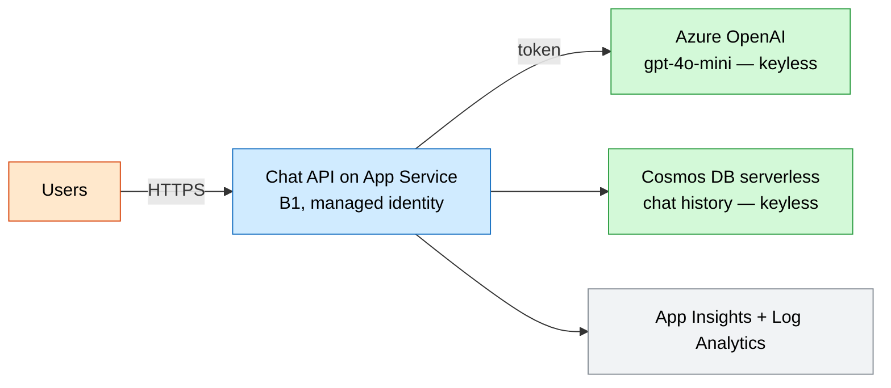
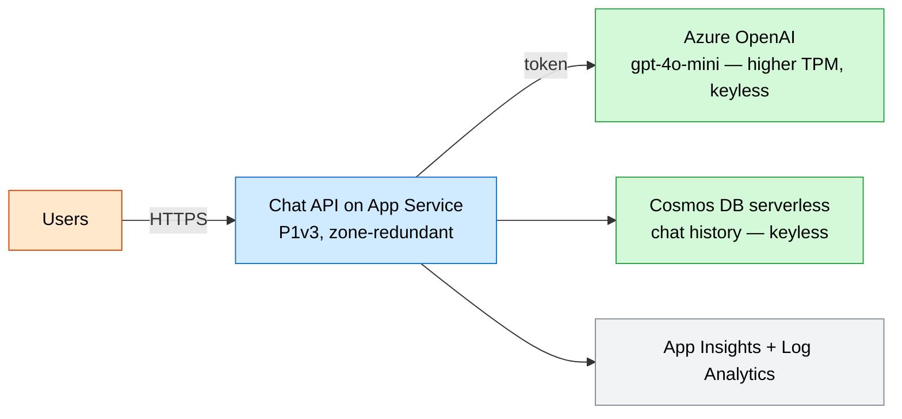

# AI Chat (Azure OpenAI + App Service + Cosmos DB)

A chat API on App Service that calls an Azure OpenAI **gpt-4o-mini** deployment
and persists conversations in **serverless Cosmos DB**. Access is **keyless**:
the web app's managed identity authenticates to both Azure OpenAI and Cosmos,
and local/key auth is disabled on both.

## Why this exists

Conversational AI is the most requested GenAI pattern. This wires the three pieces
every chatbot needs - a model endpoint, a stateless app tier, and durable
conversation storage - with keyless security and pay-per-use billing that matches
spiky chat traffic.

## Potential use cases

- A customer-support or internal helpdesk chatbot
- A product/document Q&A assistant (extend with retrieval from the AI landing zone)
- A copilot embedded in an existing web app
- A GenAI prototype you harden to production with the prod profile

## What gets deployed

| Component | Purpose | Module |
| --- | --- | --- |
| Log Analytics workspace | Central log store | [log-analytics](../../modules/log-analytics/main.bicep) |
| Application Insights | App monitoring | [app-insights](../../modules/app-insights/main.bicep) |
| Azure OpenAI account + deployment | gpt-4o-mini chat model | inline |
| Cosmos DB (serverless) + container | Conversation history | inline |
| App Service plan + Web App | Chat API with managed identity | inline |

## Well-Architected posture

- **Reliability** — zone-redundant app plan in prod; Cosmos serverless with Session consistency; stateless app tier.
- **Security** — keyless managed-identity access to OpenAI and Cosmos (local auth disabled), TLS 1.2, HTTPS-only.
- **Cost Optimization** — Cosmos serverless (pay per RU) and PAYG token billing suit spiky chat load; cheap dev profile.
- **Operational Excellence** — centralized telemetry, parameterized model/version/TPM, IaC dev/prod params.
- **Performance Efficiency** — provisioned TPM per environment, autoscaling serverless Cosmos, Premium v3 compute in prod.

See [metadata.json](metadata.json) for the machine-readable WAF + cost declaration.

> **Region note:** Azure OpenAI model availability varies by region. Pick a
> `location` that offers `gpt-4o-mini`.
>
> **After you deploy:** grant the web app's managed identity data-plane roles —
> `Cognitive Services OpenAI User` on the OpenAI account and a Cosmos DB SQL
> data role (e.g. *Cosmos DB Built-in Data Contributor*) on the account.

## Parameters

| Name | Default | Description |
| --- | --- | --- |
| `location` | resource group location | Azure region (must offer the model) |
| `environment` | `dev` | Environment name |
| `prefix` | `techlabs` | Resource name prefix |
| `appServiceSku` | `B1` | App plan SKU (P1v3+ for zone redundancy) |
| `appCapacity` | `1` | App plan instance count |
| `appZoneRedundant` | `false` | Zone-redundant app plan |
| `chatModelName` | `gpt-4o-mini` | Model to deploy |
| `chatModelVersion` | `2024-07-18` | Model version |
| `chatModelCapacity` | `10` | TPM capacity (thousands) |

## Architecture

### Dev



### Prod



## Deploy

```powershell
az group create --name rg-techlabs-aichat --location eastus

# Dev
az deployment group create `
  --resource-group rg-techlabs-aichat `
  --template-file ./main.bicep `
  --parameters ./parameters/dev.bicepparam

# Prod (zone-redundant, higher TPM)
az deployment group create `
  --resource-group rg-techlabs-aichat `
  --template-file ./main.bicep `
  --parameters ./parameters/prod.bicepparam
```

## Estimate cost

```powershell
./tools/Get-CatalogCost.ps1 -UseCase ai-chat
```

## Clean up

```powershell
az group delete --name rg-techlabs-aichat --yes --no-wait
```
