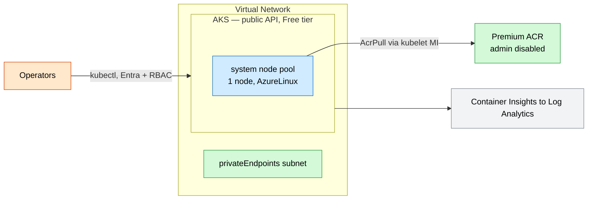
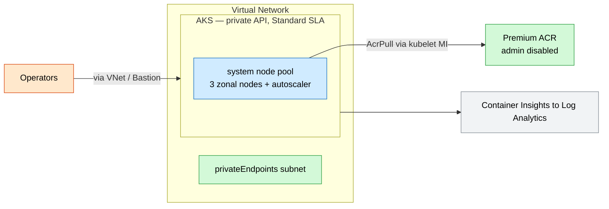

# AKS Secure Baseline

A private **AKS** cluster codifying the Microsoft AKS secure-baseline guidance: private
API server, no local accounts, Entra + Azure RBAC, workload identity, managed-identity
image pulls, and Container Insights.

## What this deploys

- **Virtual network** with `aks` and `privateEndpoints` subnets.
- **Private AKS cluster** with:
  - Azure CNI **overlay** + **Cilium** dataplane and network policy.
  - **Local accounts disabled**, Entra-managed AAD profile with **Azure RBAC**.
  - **OIDC issuer** + **workload identity** enabled.
  - **Key Vault secrets provider** addon (with rotation).
  - **Container Insights** (oms agent) to Log Analytics.
  - Zone-spread system node pool with cluster autoscaler.
- **Premium Azure Container Registry** (admin user disabled).
- **AcrPull role assignment** for the cluster's kubelet managed identity.

## Why this exists

Hand-rolled Kubernetes security drifts quickly. This template starts every cluster
compliant — private control plane, no local/secret credentials, identity-based image
pulls, and pod-level network segmentation.

## Potential use cases

- Standardized landing zone for microservices platforms.
- Regulated container workloads needing a private API server.
- Multi-team cluster with Azure RBAC namespace isolation.
- Workload-identity-based access to Key Vault, SQL, and storage.

## Architecture

### Dev



### Prod



## Deploy

```bash
# Dev (public API, single node, Free tier)
az deployment group create -g <rg> -f main.bicep -p parameters/dev.bicepparam

# Prod (private API, 3 zonal nodes, Standard tier)
az deployment group create -g <rg> -f main.bicep -p parameters/prod.bicepparam
```

> A private cluster's API server is only reachable from within the VNet (or a peered
> network / Bastion host). Pair this with [hub-spoke-network](../hub-spoke-network/README.md).

## Well-Architected highlights

- **Reliability** — zonal node pool, Standard uptime SLA, autoscaler.
- **Security** — private API, no local accounts, workload identity, AcrPull, Cilium policy.
- **Cost** — Free tier + single node in dev; autoscale in prod.
- **Operations** — Container Insights, secret rotation, surge upgrades.
- **Performance** — Cilium eBPF dataplane; overlay networking.

## Cost estimate

```powershell
./tools/Get-CatalogCost.ps1 -UseCase aks-secure-baseline
```
