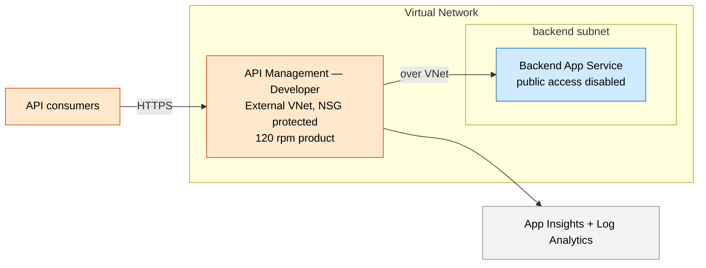
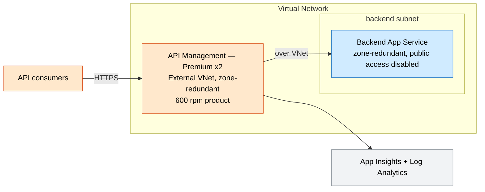

# API Gateway Landing Zone

A governed, observable, throttled entry point for enterprise APIs: **API Management**
in **VNet** mode fronting a **private App Service** backend, with a rate-limited product
and Application Insights logging.

## What this deploys

- **API Management** (Developer/Premium) in **External VNet** mode, injected into a subnet protected by a least-privilege **NSG** (allows the required management `3443` / load-balancer `6390` and inbound `443`).
- **Backend App Service** with VNet integration and **public access disabled** — reachable only through the gateway over the VNet.
- A **published product** (`standard`) applying a **rate-limit** policy, with subscription + approval gating.
- A **backend API** wired to the App Service.
- **APIM → Application Insights** logger and **Log Analytics**.

## Why this exists

Enterprises expose many backend services and need one governed, metered, throttled
entry point rather than bespoke per-app gateways. This establishes the API platform
with VNet isolation, policy, and metering as first-class concerns.

## Potential use cases

- Central API platform for internal and partner APIs.
- Monetized or quota-limited public API program.
- Facade and versioning layer in front of legacy services.
- Policy enforcement (auth, rate limit, transformation) at the edge.

## Architecture

### Dev



### Prod



## Deploy

```bash
# Dev (Developer SKU)
az deployment group create -g <rg> -f main.bicep -p parameters/dev.bicepparam

# Prod (Premium x2, zone-redundant backend)
az deployment group create -g <rg> -f main.bicep -p parameters/prod.bicepparam
```

> APIM provisioning takes a while (especially Premium). The Developer SKU has no SLA and
> is intended for non-production.

## Well-Architected highlights

- **Reliability** — Premium multi-unit APIM; zone-redundant backend in prod.
- **Security** — private backend, VNet-injected APIM with NSG, gated products.
- **Cost** — Developer SKU + P0v3 in dev; capacity scaled per environment.
- **Operations** — gateway telemetry to App Insights; policy/products as code.
- **Performance** — rate limiting protects backends; scale units tune throughput.

## Cost estimate

```powershell
./tools/Get-CatalogCost.ps1 -UseCase api-management-gateway
```
