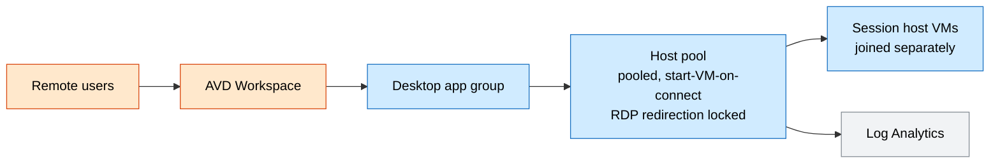
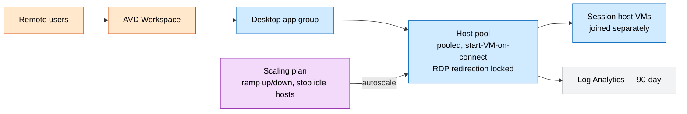

# Azure Virtual Desktop Landing Zone

The **control plane** for secure, cost-managed remote desktops: a pooled **host pool**,
a **desktop application group**, a **workspace**, and an optional **autoscaling plan** —
with diagnostics to Log Analytics.

## What this deploys

- **Host pool** (Pooled, breadth-first, **start-VM-on-connect**) with **hardened RDP properties** that block clipboard / printer / drive redirection.
- **Desktop application group** published through a **workspace**.
- **Autoscaling plan** (optional) — ramps hosts up for business hours, stops idle hosts off-peak.
- Host pool **diagnostics** → **Log Analytics**.

## Why this exists

Organizations need secure, centrally governed remote desktops for contractors, BYOD,
regulated data access, and burst workforces — without shipping data to endpoints. This
establishes the AVD control plane and autoscaling so session hosts can be joined into a
governed, observable, cost-managed pool.

## Potential use cases

- Secure remote access for contractors and third parties.
- Regulated data access where data must stay in Azure.
- Seasonal or burst workforce desktop provisioning.
- BYOD / unmanaged-device access to corporate apps.

## Architecture

### Dev



### Prod



## Deploy

```bash
# Dev (no scaling plan)
az deployment group create -g <rg> -f main.bicep -p parameters/dev.bicepparam

# Prod (autoscaling enabled)
az deployment group create -g <rg> -f main.bicep -p parameters/prod.bicepparam
```

> This provisions the AVD **control plane**. Session host VMs are joined separately
> (image, domain/Entra join, FSLogix profile storage) so you can pick the VM family and
> image that fit your workload. The host pool registration token gates host joins.

## Well-Architected highlights

- **Reliability** — breadth-first pool; control plane decoupled from hosts.
- **Security** — redirection-locked RDP, data stays in Azure, audit logs centralized.
- **Cost** — autoscaling + start-on-connect; scaling disabled in dev.
- **Operations** — connection/diagnostic logs in Log Analytics; control plane as code.
- **Performance** — per-host session limit + breadth-first balancing at peak.

## Cost estimate

```powershell
./tools/Get-CatalogCost.ps1 -UseCase avd-hostpool
```

> The AVD control plane is free; cost is driven by the **session host VMs** you attach
> (priced separately — the estimate models an example pool).
