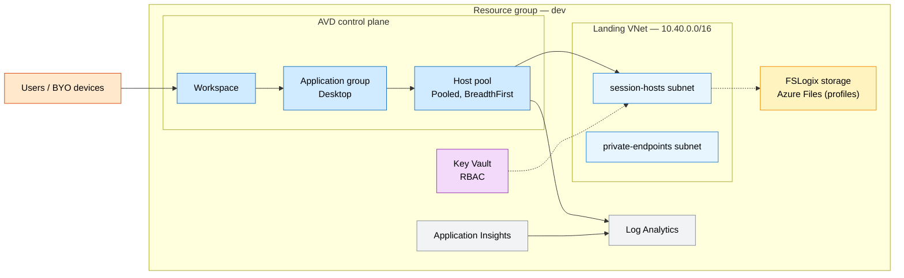
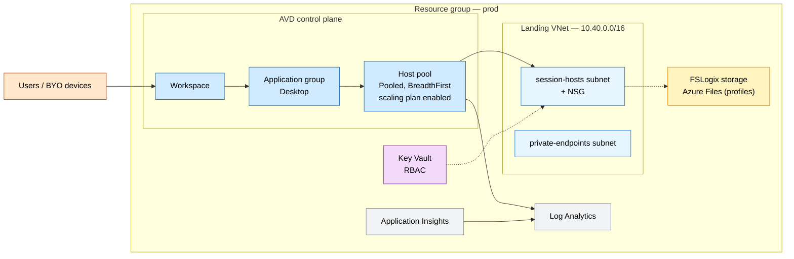

# Azure Virtual Desktop Enterprise

An enterprise-ready Azure Virtual Desktop (AVD) landing zone: a pooled host pool
with an application group and workspace, an optional scaling plan, FSLogix profile
storage on Azure Files, a landing virtual network with session-host and
private-endpoint subnets, a Key Vault and network-security baseline, and
centralized monitoring in Azure Monitor. Dev validates with a minimal footprint;
prod is sized for production desktop operations.

## Why this exists

Organizations standardizing remote and hybrid work need a governed, repeatable
way to stand up AVD with persistent user profiles, secure networking, and
observability from day one. Wiring the host pool, FSLogix storage, landing
network, secret management, and diagnostics into one composable template
accelerates rollout while preserving operational consistency across environments.

## Potential use cases

- Pooled desktops for knowledge workers and contractors
- Secure access to corporate apps for unmanaged or BYO devices
- Seasonal or burst capacity for call centers and task workers
- Standardized desktop estate during mergers, acquisitions, or datacenter exits

## What gets deployed

| Component | Purpose | Module |
| --- | --- | --- |
| Host pool + app group + workspace | Pooled desktops with breadth-first load balancing and optional scaling plan | [modules/avd](modules/avd/main.bicep) |
| FSLogix profile storage | Azure Files share for roaming user-profile containers | [modules/fslogix](modules/fslogix/main.bicep) |
| Virtual network + subnets | Landing network with session-hosts and private-endpoints subnets | [modules/networking](modules/networking/main.bicep) |
| Key Vault + NSG | RBAC-enabled secret store and session-host network security baseline | [modules/security](modules/security/main.bicep) |
| Log Analytics + App Insights | Centralized telemetry for host pool and platform diagnostics | [modules/monitoring](modules/monitoring/main.bicep) |

## Well-Architected posture

- **Reliability** — pooled host pool with breadth-first load balancing across session hosts; FSLogix profile containers on Azure Files for stateless, roaming profiles; environment-specific parameterization for controlled dev/prod rollout.
- **Security** — RBAC-enabled Key Vault baseline; network segmentation with dedicated session-host and private-endpoint subnets plus NSG; storage hardened with TLS 1.2, HTTPS-only, and no public blob access.
- **Cost Optimization** — optional scaling plan ramps session hosts down off-peak; start-VM-on-connect avoids running idle hosts; use the dev profile for early validation before production scale.
- **Operational Excellence** — Infrastructure as Code modules for repeatable deployment; unified logging via Log Analytics and Application Insights; dev/prod parameter files.
- **Performance Efficiency** — tunable max session limit per host to balance density and experience; breadth-first load balancing spreads users; TransactionOptimized Azure Files tier for responsive profile I/O.

See [metadata.json](metadata.json) for the machine-readable WAF + cost declaration.

## Parameters

Top-level orchestration ([main.bicep](main.bicep)):

| Name | Default | Description |
| --- | --- | --- |
| `location` | resource group location | Azure region for the landing zone |
| `environmentName` | `dev` | Environment name, used in resource names and tags |
| `namePrefix` | `avd` | Prefix for resource names (2–10 chars) |
| `avdMetadataLocation` | `eastus` | Metadata region for host pool, app group, and workspace control-plane objects |
| `maxSessionLimit` | `10` | Maximum user sessions per session host VM |
| `startVmOnConnect` | `true` | Start stopped session host VMs when users connect |
| `enableScalingPlan` | `true` | Deploy an AVD scaling plan for the host pool |
| `scalingTimeZone` | `Eastern Standard Time` | Time zone used by the scaling schedule |
| `vnetAddressPrefixes` | `10.40.0.0/16` | Landing virtual network address space |
| `sessionHostsSubnetPrefix` | `10.40.1.0/24` | Session-hosts subnet prefix |
| `privateEndpointSubnetPrefix` | `10.40.2.0/24` | Private-endpoints subnet prefix |
| `enableRbacAuthorization` | `true` | Use RBAC for Key Vault data-plane access |
| `fslogixProfileShareName` | `profiles` | Azure Files share name for FSLogix profile containers |
| `retentionInDays` | `30` | Log Analytics retention (30–730) |

> The FSLogix storage account name is derived automatically from `namePrefix`
> and a per-resource-group hash to satisfy the global, lowercase, 3–24 character
> naming rules for storage accounts.

## Architecture

### Dev



### Prod



## Deploy

```powershell
az group create --name rg-techlabs-avd --location eastus

# Dev
az deployment group create `
  --resource-group rg-techlabs-avd `
  --template-file ./main.bicep `
  --parameters ./parameters/dev.bicepparam

# Prod
az deployment group create `
  --resource-group rg-techlabs-avd `
  --template-file ./main.bicep `
  --parameters ./parameters/prod.bicepparam
```

> This template provisions the AVD control plane, profile storage, networking,
> security, and monitoring scaffolding. Session host VMs are added separately
> (image, domain/Entra join, and host-pool registration) to fit your identity
> and image-management approach.

## Estimate cost

```powershell
./tools/Get-CatalogCost.ps1 -UseCase azure-virtual-desktop-enterprise
```

> The estimate models example session-host, profile-storage, and monitoring costs.
> Replace quantities and assumptions in `metadata.json` to reflect your target
> region, host count, and scaling schedule.

## Clean up

```powershell
az group delete --name rg-techlabs-avd --yes --no-wait
```
