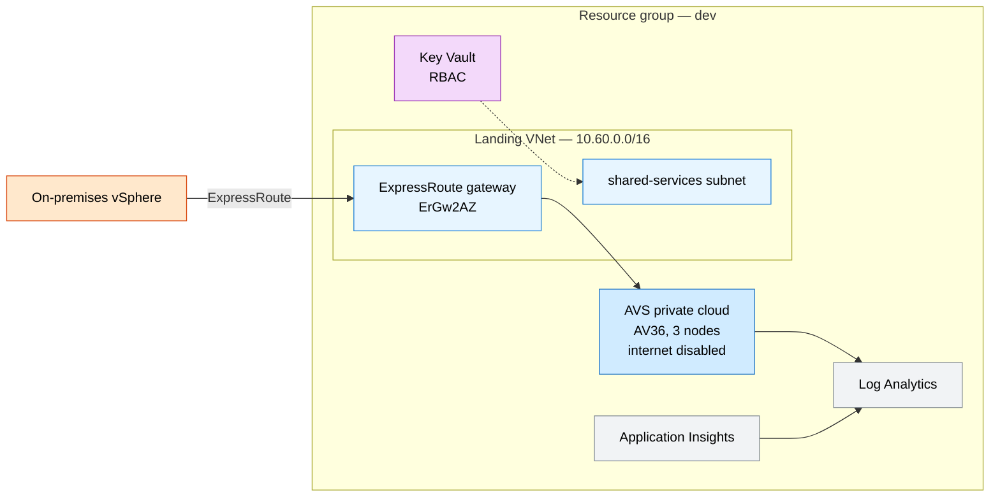
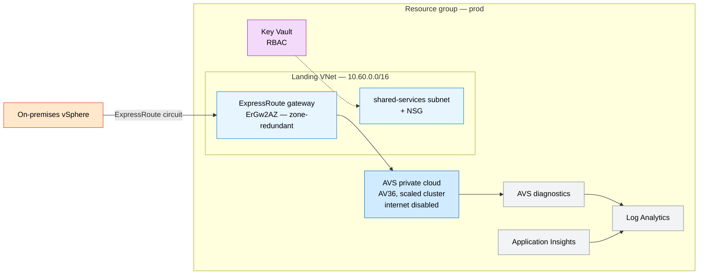

# Azure VMware Solution Enterprise

An enterprise-ready Azure VMware Solution (AVS) landing zone: a dedicated AVS
private cloud, a landing virtual network with a `GatewaySubnet`, a Key Vault and
network-security baseline, optional ExpressRoute gateway connectivity, and
centralized monitoring in Azure Monitor. Dev validates with a minimal footprint;
prod is sized for production hybrid operations.

## Why this exists

Organizations migrating vSphere workloads to Azure need a governed, repeatable
way to stand up AVS with secure connectivity and observability from day one.
Wiring the private cloud, landing network, secret management, hybrid connectivity,
and diagnostics into one composable template accelerates datacenter exits while
preserving operational consistency across environments.

## Potential use cases

- Datacenter exit and lift-and-shift of VMware workloads
- Capacity expansion for existing on-premises vSphere clusters
- Disaster recovery target for critical VMware applications
- Hybrid operations while modernizing applications over time

## What gets deployed

| Component | Purpose | Module |
| --- | --- | --- |
| AVS private cloud | Isolated VMware management cluster (AV36, internet disabled) | [modules/avs](modules/avs/main.bicep) |
| Virtual network + subnets | Landing network with `GatewaySubnet` and shared-services subnet | [modules/networking](modules/networking/main.bicep) |
| Key Vault + NSG | RBAC-enabled secret store and shared-services network security baseline | [modules/security](modules/security/main.bicep) |
| ExpressRoute gateway | `ErGw2AZ` zone-redundant gateway with optional circuit connection | [modules/connectivity](modules/connectivity/main.bicep) |
| Log Analytics + App Insights | Centralized telemetry with optional AVS diagnostic settings | [modules/monitoring](modules/monitoring/main.bicep) |

## Well-Architected posture

- **Reliability** — dedicated AVS private cloud for isolated VMware operations; zone-redundant ExpressRoute gateway (`ErGw2AZ`); environment-specific parameterization for controlled dev/prod rollout.
- **Security** — RBAC-enabled Key Vault baseline; network segmentation with dedicated `GatewaySubnet` and shared-services subnet plus NSG; AVS private cloud with internet access disabled; optional control-plane diagnostics.
- **Cost Optimization** — right-size AVS node count per environment (minimum 3); use the dev profile for early validation before production scale; centralized monitoring to track utilization.
- **Operational Excellence** — Infrastructure as Code modules for repeatable deployment; unified logging via Log Analytics and Application Insights; dev/prod parameter files.
- **Performance Efficiency** — ExpressRoute-ready connectivity for low-latency hybrid traffic; scalable AVS cluster size parameter to match workload demand.

See [metadata.json](metadata.json) for the machine-readable WAF + cost declaration.

## Parameters

Top-level orchestration ([main.bicep](main.bicep)):

| Name | Default | Description |
| --- | --- | --- |
| `location` | resource group location | Azure region |
| `environmentName` | `dev` | Environment name, used in resource names and outputs |

Key module knobs (set via the module composition):

| Module | Name | Default | Description |
| --- | --- | --- | --- |
| avs | `skuName` | `AV36` | AVS private cloud SKU |
| avs | `clusterSize` | `3` | Management cluster node count (minimum 3) |
| avs | `networkBlock` | `10.250.0.0/22` | AVS management network address block |
| networking | `vnetAddressPrefixes` | `10.60.0.0/16` | Landing virtual network address space |
| networking | `gatewaySubnetPrefix` | `10.60.0.0/27` | `GatewaySubnet` prefix for ExpressRoute |
| networking | `sharedServicesSubnetPrefix` | `10.60.1.0/24` | Shared services / jumpbox subnet prefix |
| security | `enableRbacAuthorization` | `true` | Use RBAC for Key Vault data-plane access |
| connectivity | `avsExpressRouteAuthorizationId` | `''` | AVS ExpressRoute circuit authorization ID; empty skips the connection |
| monitoring | `retentionInDays` | `30` | Log Analytics retention (30–730) |
| monitoring | `avsPrivateCloudName` | `''` | AVS private cloud name for diagnostics; empty skips AVS diagnostics |

## Architecture

### Dev



### Prod



## Deploy

```powershell
az group create --name rg-techlabs-avs --location eastus

# Dev
az deployment group create `
  --resource-group rg-techlabs-avs `
  --template-file ./main.bicep `
  --parameters ./parameters/dev.bicepparam

# Prod
az deployment group create `
  --resource-group rg-techlabs-avs `
  --template-file ./main.bicep `
  --parameters ./parameters/prod.bicepparam
```

## Estimate cost

```powershell
./tools/Get-CatalogCost.ps1 -UseCase azure-vmware-solution-enterprise
```

> The estimate models example AVS node, connectivity, and monitoring costs. Replace
> quantities and assumptions in `metadata.json` to reflect your target region and sizing.

## Clean up

```powershell
az group delete --name rg-techlabs-avs --yes --no-wait
```
