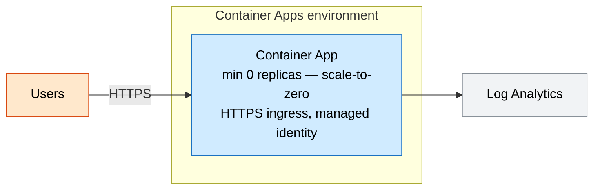
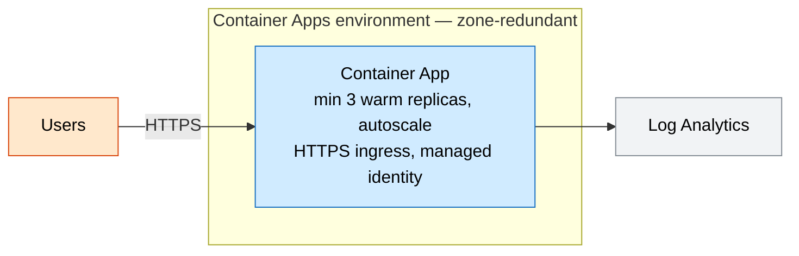

# Container App (serverless containers)

Run any container image on Azure Container Apps with HTTP autoscaling and
streamed logs. Dev scales to zero to keep costs near nothing; prod runs a warm,
zone-redundant baseline.

## Why this exists

When you already have a containerized app, Container Apps gives you serverless
scale (including scale-to-zero) and revision-based rollouts without operating
Kubernetes. You pay per second of actual usage, which suits spiky or intermittent
workloads.

## Potential use cases

- Microservices or event-driven workers that scale with load
- A containerized API or background processor with bursty traffic
- Cost-sensitive dev/test apps that should idle at near-zero cost
- Migrating a Docker Compose app to managed, autoscaling hosting

## What gets deployed

| Component | Purpose |
| --- | --- |
| Log Analytics workspace | Container log/metric store |
| Container Apps environment | Managed runtime (optionally zone-redundant) |
| Container App | Your image with external HTTPS ingress + managed identity |

## Well-Architected posture

- **Reliability** — zone-redundant environment and warm baseline replicas in prod; managed rolling revisions.
- **Security** — system-assigned managed identity, HTTPS-only ingress, no secrets baked into the image.
- **Cost Optimization** — scale-to-zero in dev; per-second vCPU/memory billing; right-sized replicas.
- **Operational Excellence** — logs to Log Analytics, revision-based deployments, IaC dev/prod params.
- **Performance Efficiency** — HTTP concurrency autoscaling, independent per-replica sizing.

See [metadata.json](metadata.json) for the machine-readable WAF + cost declaration.

## Parameters

| Name | Default | Description |
| --- | --- | --- |
| `location` | resource group location | Azure region |
| `environment` | `dev` | Environment name |
| `prefix` | `techlabs` | Resource name prefix |
| `containerImage` | quickstart image | Image to run |
| `cpu` | `0.5` | vCPU per replica |
| `memory` | `1.0Gi` | Memory per replica |
| `minReplicas` | `0` | Min replicas (0 = scale to zero) |
| `maxReplicas` | `5` | Max replicas |
| `zoneRedundant` | `false` | Zone-redundant environment |
| `targetPort` | `80` | Container listen port |

## Architecture

### Dev



### Prod



## Deploy

```powershell
az group create --name rg-techlabs-aca --location eastus

# Dev (scale to zero)
az deployment group create `
  --resource-group rg-techlabs-aca `
  --template-file ./main.bicep `
  --parameters ./parameters/dev.bicepparam

# Prod (warm, zone-redundant)
az deployment group create `
  --resource-group rg-techlabs-aca `
  --template-file ./main.bicep `
  --parameters ./parameters/prod.bicepparam
```

## Estimate cost

```powershell
./tools/Get-CatalogCost.ps1 -UseCase container-app
```

## Clean up

```powershell
az group delete --name rg-techlabs-aca --yes --no-wait
```
