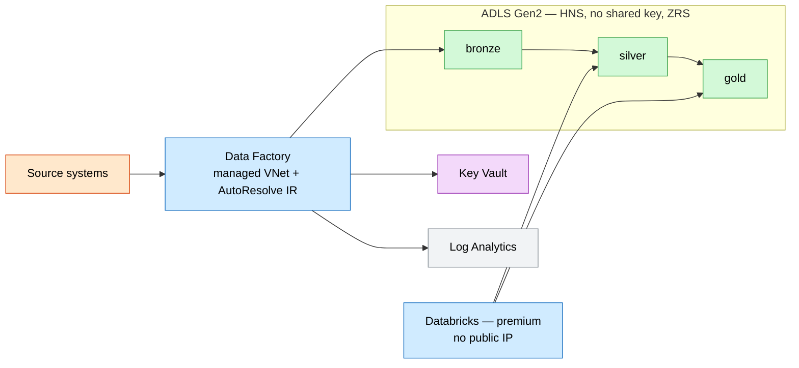

# Medallion Data Lakehouse

The **medallion** (bronze → silver → gold) pattern on Azure: an **ADLS Gen2** lake, a
private **Data Factory** orchestration plane, a secure **Databricks** workspace, and
**Key Vault** for secrets.

## What this deploys

- **ADLS Gen2** storage (hierarchical namespace, **shared-key access disabled**, no public blob) with `bronze`, `silver`, and `gold` containers.
- **Azure Data Factory** with a **managed virtual network** and AutoResolve integration runtime, plus a system-assigned identity holding **Blob Data Contributor** on the lake.
- **Azure Databricks** (premium) workspace with **secure cluster connectivity** (no public IP) for transformation.
- **Key Vault** (RBAC) for secrets.
- **Log Analytics** with Data Factory diagnostics.

## Why this exists

Analytics platforms standardize on the medallion pattern to progressively refine data
from raw to curated. This lays down the storage zones, a private orchestration plane,
and a governed compute engine so data teams start from a secure, structured foundation.

## Potential use cases

- Enterprise data platform feeding BI and ML.
- Batch + incremental ingestion from operational systems into a lake.
- Regulatory reporting datasets curated through gold tables.
- Feature engineering and model training on Databricks.

## Architecture

### Dev


### Prod



## Deploy

```bash
# Dev (LRS lake, standard Databricks)
az deployment group create -g <rg> -f main.bicep -p parameters/dev.bicepparam

# Prod (ZRS lake, premium Databricks, no public IP)
az deployment group create -g <rg> -f main.bicep -p parameters/prod.bicepparam
```

> Databricks provisions a separate managed resource group (`<prefix>-dbw-managed`) for
> its compute plane.

## Well-Architected highlights

- **Reliability** — ZRS lake; managed IR auto-resolves region/scale.
- **Security** — no shared keys, managed-VNet ADF, no-public-IP Databricks, Key Vault.
- **Cost** — standard Databricks + LRS in dev; job clusters scale to workload.
- **Operations** — ADF diagnostics to Log Analytics; explicit zoned containers.
- **Performance** — HNS for analytics IO; Databricks compute tuned per stage.

## Cost estimate

```powershell
./tools/Get-CatalogCost.ps1 -UseCase data-lakehouse
```
