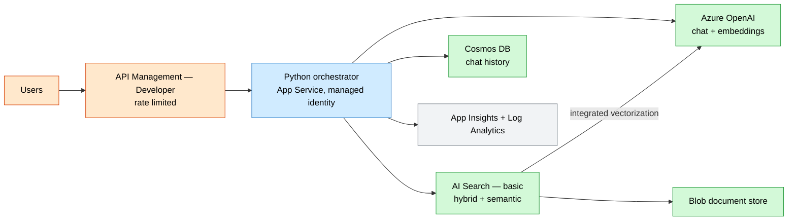
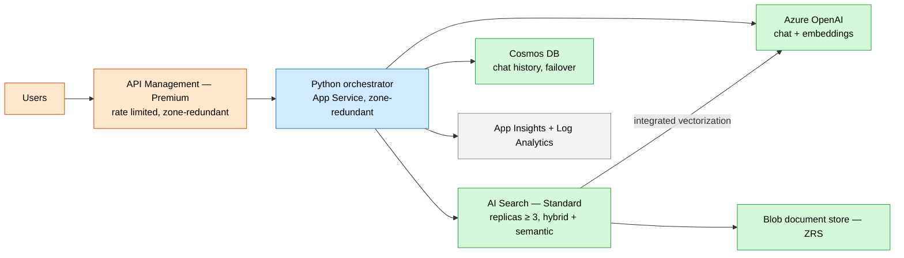

# Enterprise RAG Platform

A keyless, end-to-end **retrieval-augmented generation** stack: Azure OpenAI (chat +
embeddings), Azure AI Search (hybrid + semantic), Cosmos DB chat history, a blob
document store, a Python orchestrator on App Service, and API Management out front.

## What this deploys

- **Azure OpenAI** with a chat deployment (`gpt-5-mini`) and an embedding deployment (`text-embedding-3-large`), `disableLocalAuth: true`, custom subdomain.
- **Azure AI Search** (system identity, keyless, semantic search) for hybrid retrieval and integrated vectorization.
- **Cosmos DB** (serverless, keyless) storing chat history, partitioned by `sessionId`.
- **Storage account** holding source documents.
- **App Service** (Python) orchestrator with system identity and endpoint app settings.
- **API Management** fronting the orchestrator with a subscription-gated API.
- **Application Insights** + **Log Analytics**.
- **Least-privilege role assignments**:
  - App → OpenAI (`Cognitive Services OpenAI User`)
  - Search → OpenAI (integrated vectorization)
  - App → Search (`Index Data Reader` + `Service Contributor`)
  - Search → Storage (`Blob Data Reader`)
  - App → Cosmos (data-plane SQL RBAC, `Built-in Data Contributor`)

## Why this exists

Teams want grounded, governed generative answers over their own content without
standing up keys, secrets, or bespoke glue. This wires the canonical RAG components
together with managed-identity RBAC and a managed API facade so it is auditable and
rate-limited from day one.

## Potential use cases

- Internal knowledge assistant grounded in policy and product docs.
- Customer support copilot over a manual / KB corpus.
- Contract and claims Q&A with citations.
- Developer portal for governed access to a shared LLM via APIM.

## Architecture

### Dev



### Prod



## Deploy

> Azure OpenAI model availability and quota vary by region — confirm `chatModel` /
> `embeddingModel` are available before deploying.

```bash
# Dev (basic Search, Developer APIM)
az deployment group create -g <rg> -f main.bicep -p parameters/dev.bicepparam

# Prod (zone-redundant, Premium APIM)
az deployment group create -g <rg> -f main.bicep -p parameters/prod.bicepparam
```

## Well-Architected highlights

- **Reliability** — zone-redundant app/storage, Cosmos failover, Search replicas.
- **Security** — local auth disabled everywhere, least-privilege RBAC, APIM policy.
- **Cost** — serverless Cosmos, dev runs Developer APIM + basic Search.
- **Operations** — full App Insights/Log Analytics coverage in one template.
- **Performance** — semantic + vector hybrid retrieval; independent model scaling.

## Cost estimate

```powershell
./tools/Get-CatalogCost.ps1 -UseCase enterprise-rag
```
