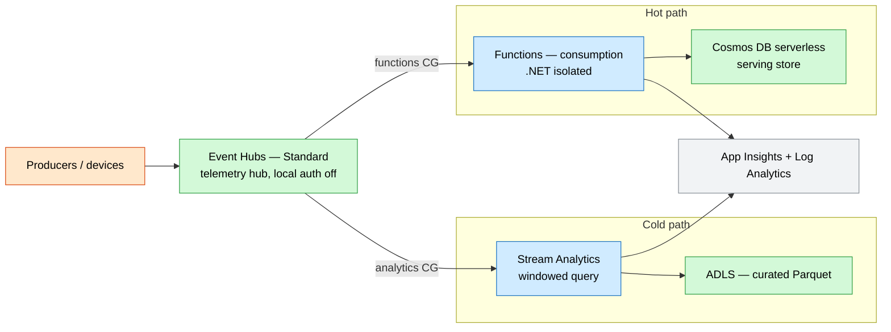
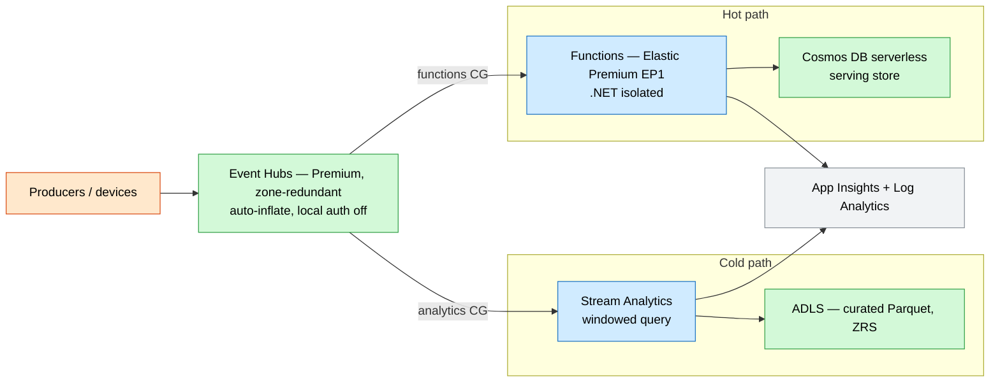

# Real-Time Event Streaming & Analytics

A managed real-time pipeline with a **cold path** (durable, curated lake) and a **hot
path** (low-latency serving), fed from a single **Event Hubs** ingestion stream — fully
keyless via managed identity.

## What this deploys

- **Event Hubs namespace** (Standard/Premium, local auth disabled) with a `telemetry` hub and two consumer groups (`analytics`, `functions`).
- **Stream Analytics** job (system identity) reading the `analytics` consumer group, applying a windowed query, and writing **curated Parquet** to a `curated` blob container.
- **Functions app** (.NET isolated, Elastic Premium / consumption) reading the `functions` consumer group for the hot path, with identity-based host storage.
- **Cosmos DB** (serverless, keyless) serving store partitioned by `deviceId`.
- **Lake** + **function** storage accounts, **Application Insights**, **Log Analytics**.
- **Role assignments**: Stream Analytics → Event Hubs receiver + lake blob contributor; Functions → Event Hubs receiver + host storage + Cosmos data contributor.

## Why this exists

Telemetry, clickstream, and IoT workloads need both a cheap durable cold path and a
low-latency hot path off the same stream. This separates those concerns with managed
services — no Kafka clusters to operate, no SAS keys to rotate.

## Potential use cases

- IoT / fleet telemetry ingestion and curation.
- Clickstream and product analytics pipeline.
- Fraud / anomaly hot path with a durable replay log.
- Operational metrics fan-out to a serving store and a lake.

## Architecture

### Dev



### Prod



## Deploy

```bash
# Dev (Standard Event Hubs, consumption Functions)
az deployment group create -g <rg> -f main.bicep -p parameters/dev.bicepparam

# Prod (Premium Event Hubs, EP1 Functions, zone-redundant)
az deployment group create -g <rg> -f main.bicep -p parameters/prod.bicepparam
```

## Well-Architected highlights

- **Reliability** — zone-redundant ingestion/storage/serving; replayable retention.
- **Security** — local auth disabled, identity-based host storage, Cosmos SQL RBAC.
- **Cost** — auto-inflate + consumption Functions in dev; serverless Cosmos.
- **Operations** — App Insights + Log Analytics; declarative ASA query in IaC.
- **Performance** — partitioned hub parallelism; Elastic Premium scale-out.

## Cost estimate

```powershell
./tools/Get-CatalogCost.ps1 -UseCase event-streaming-analytics
```
