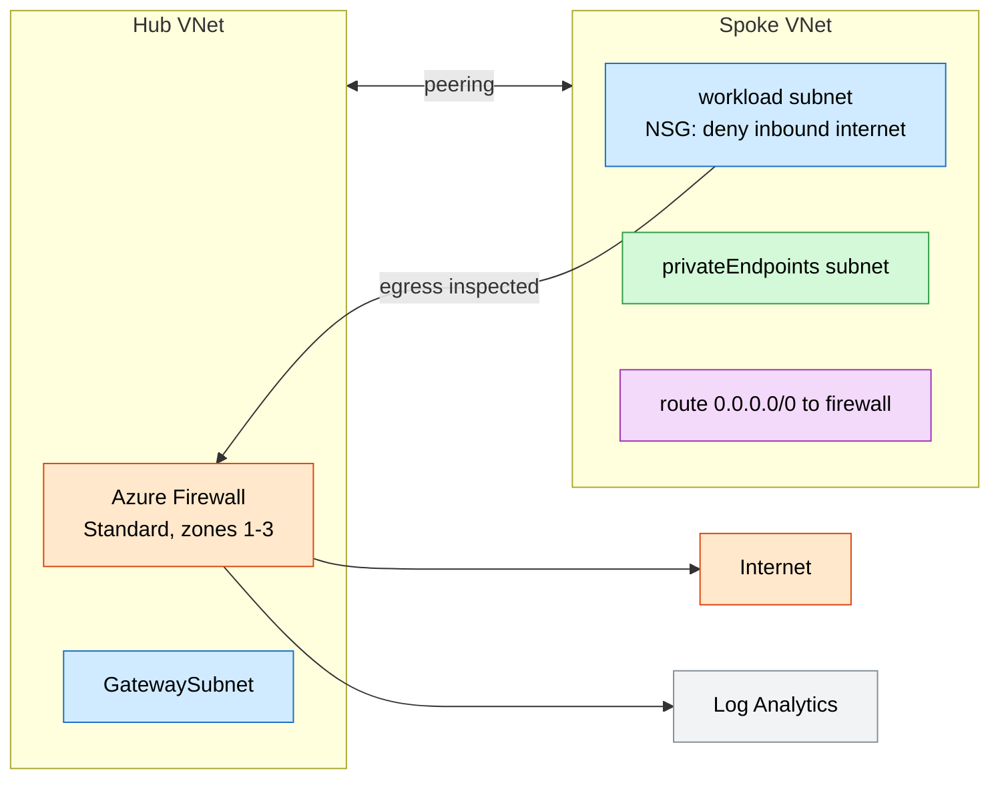
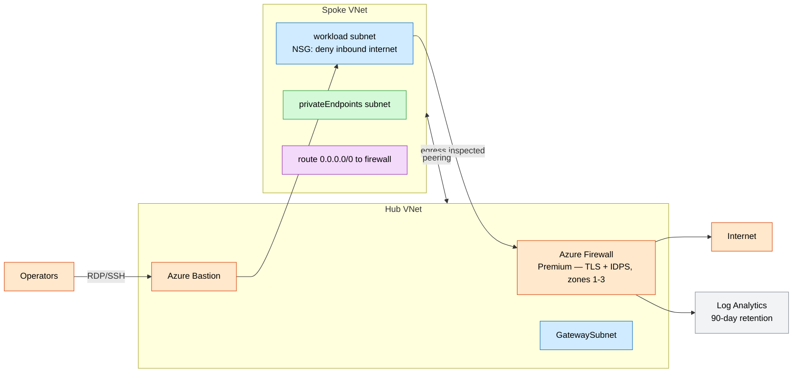

# Hub-and-Spoke Network (Firewall + Bastion)

Enterprise hub-and-spoke topology: a hub VNet with a zone-redundant **Azure Firewall**,
**Azure Bastion**, and a gateway subnet, peered to a workload **spoke** whose default
route is forced through the firewall for egress inspection.

## What this deploys

- **Hub VNet** with `AzureFirewallSubnet`, `AzureBastionSubnet`, and `GatewaySubnet`.
- **Azure Firewall** (Standard/Premium) across zones 1-3 with a reusable **firewall policy** and an egress rule collection.
- **Azure Bastion** (optional) for RDP/SSH to private workloads without public IPs.
- **Spoke VNet** with `workload` and `privateEndpoints` subnets, an NSG denying inbound internet, and a **route table** sending `0.0.0.0/0` to the firewall's private IP.
- **Bidirectional VNet peering** between hub and spoke.
- **Log Analytics** workspace receiving firewall diagnostics.

## Why this exists

Centralized egress inspection, no public IPs on workloads, and a single audited path
to the internet are baseline requirements for regulated landing zones. This is the
connectivity substrate that web, container, data, and AI workloads peer into.

## Potential use cases

- Connectivity subscription for an Azure landing zone.
- Forced-tunnel egress inspection for regulated workloads (PCI, HIPAA, IRAP).
- Secure jump-box access to private VMs via Bastion.
- Central firewall policy shared across multiple spokes.

## Architecture

### Dev



### Prod



## Deploy

```bash
# Dev (Standard firewall, no Bastion)
az deployment group create -g <rg> -f main.bicep -p parameters/dev.bicepparam

# Prod (Premium firewall, Bastion, 90-day logs)
az deployment group create -g <rg> -f main.bicep -p parameters/prod.bicepparam
```

## Well-Architected highlights

- **Reliability** — firewall and public IPs are zone-redundant.
- **Security** — all spoke egress is inspected; inbound internet is denied; Bastion removes public IPs; Premium tier adds TLS inspection + IDPS.
- **Cost** — Bastion and Premium tier are prod-only.
- **Operations** — firewall logs/metrics flow to Log Analytics; rules live in a central policy.
- **Performance** — zone-redundant firewall scales with throughput.

## Cost estimate

```powershell
./tools/Get-CatalogCost.ps1 -UseCase hub-spoke-network
```
