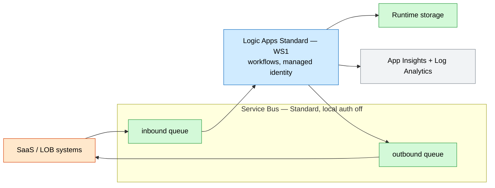

# Enterprise Integration (Logic Apps Standard)

A managed iPaaS foundation: **Logic Apps Standard** workflows over a **Service Bus**
messaging backbone, with **keyless** connectors via managed identity.

## What this deploys

- **Logic Apps Standard** plan (`WS1`–`WS3`, Workflow Standard tier) hosting stateful/stateless workflows.
- **Service Bus** namespace (Standard/Premium, **local auth disabled**) with `inbound` and `outbound` queues + dead-lettering.
- **Managed identity** on the Logic App with **Service Bus Data Owner** for keyless connectors (`serviceBus__fullyQualifiedNamespace`).
- **Runtime storage** account (no public blob).
- **Application Insights** + **Log Analytics**.

## Why this exists

Integration teams stitch SaaS, on-prem, and Azure systems together and need a managed,
versionable workflow runtime with durable messaging — without standing up legacy
middleware. Logic Apps Standard plus Service Bus delivers that with identity-based,
audited connectivity.

## Potential use cases

- B2B / EDI message processing and routing.
- SaaS-to-line-of-business system synchronization.
- Order, invoice, or claim orchestration across systems.
- Event-driven enterprise application integration (EAI).

## Architecture

### Dev



### Prod


## Deploy

```bash
# Dev (WS1, Standard Service Bus)
az deployment group create -g <rg> -f main.bicep -p parameters/dev.bicepparam

# Prod (WS3, Premium Service Bus, zone-redundant)
az deployment group create -g <rg> -f main.bicep -p parameters/prod.bicepparam
```

> Workflow definitions are deployed separately (e.g. via the Logic Apps Standard
> project / `workflow.json`); this template provisions the runtime and messaging.

## Well-Architected highlights

- **Reliability** — dead-lettered queues, Premium zone-redundant broker, durable state.
- **Security** — keyless Service Bus, TLS 1.2, no public blob.
- **Cost** — WS1 + Standard broker in dev; elastic plan scales to load.
- **Operations** — run history/metrics in App Insights; workflows as code.
- **Performance** — decoupled queues smooth bursty traffic.

## Cost estimate

```powershell
./tools/Get-CatalogCost.ps1 -UseCase integration-workflow
```
