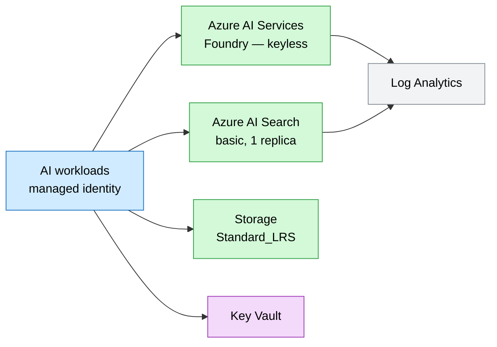
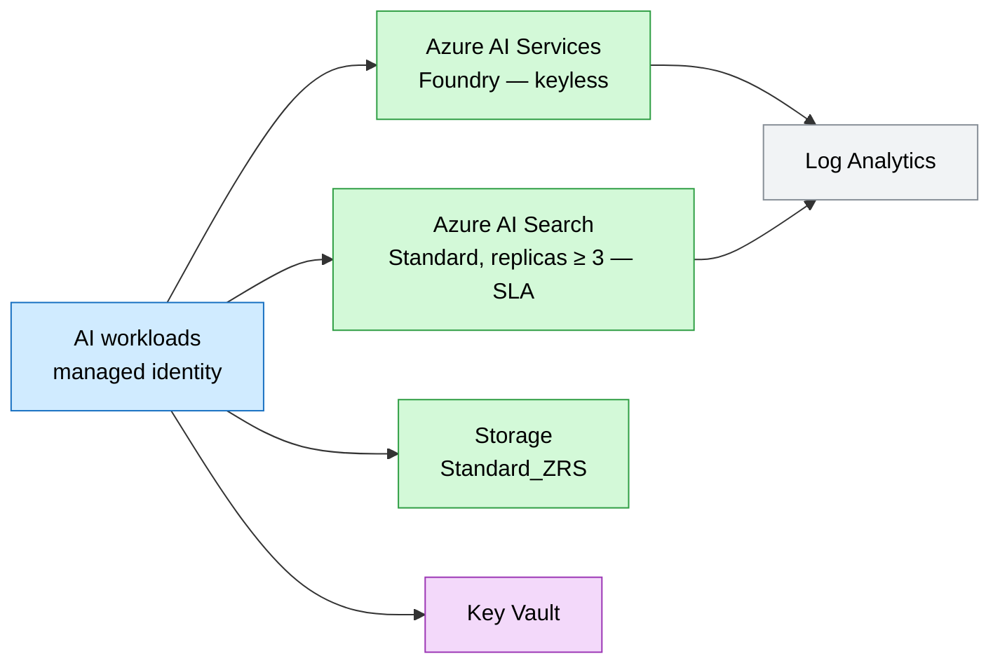

# AI / GenAI Landing Zone

A shared foundation for generative-AI workloads: Azure AI Services (Foundry),
Azure AI Search, Key Vault, hardened Storage, and Log Analytics — all keyless and
managed-identity ready. AI use cases (like [ai-chat](../../ai-chat/)) build on top
of it.

## Why this exists

GenAI apps (RAG chatbots, agents, copilots) repeatedly need the same backbone: a
models endpoint, a vector/keyword index, durable storage for documents, a place
for secrets, and centralized telemetry. Standing this up once as a governed,
keyless landing zone lets every AI use case plug in without re-solving identity,
networking, and observability.

## Potential use cases

- Foundation for RAG chat apps and AI agents that build on top
- Shared AI platform for several app teams in a business unit
- Hackathon / lab environment for GenAI prototyping with guardrails
- Base you extend with private endpoints + customer-managed keys for regulated AI

## What gets deployed

| Component | Purpose | Module |
| --- | --- | --- |
| Log Analytics workspace | Central AI telemetry | [log-analytics](../../../modules/log-analytics.bicep) |
| Key Vault | Secrets, RBAC + soft delete | [key-vault](../../../modules/key-vault.bicep) |
| Storage account | Grounding/document storage | [storage-account](../../../modules/storage-account.bicep) |
| Azure AI Services (Foundry) | Model endpoint, keyless | inline |
| Azure AI Search | Retrieval / RAG index, keyless | inline |

## Well-Architected posture

- **Reliability** — scaled, SLA-backed AI Search in prod (replicas ≥ 3); zone-redundant storage option; regional Log Analytics.
- **Security** — keyless: local auth disabled on AI Services and Search (Entra + managed identity only); Key Vault for any secrets.
- **Cost Optimization** — basic search + LRS in dev; scale up only for prod; one shared foundation amortized across AI workloads.
- **Operational Excellence** — centralized telemetry, IaC dev/prod params, managed identities remove credential toil.
- **Performance Efficiency** — search replicas/partitions tuned per environment; semantic ranking available; regional co-location.

See [metadata.json](metadata.json) for the machine-readable WAF + cost declaration.

## Parameters

| Name | Default | Description |
| --- | --- | --- |
| `location` | resource group location | Azure region (must offer the models you need) |
| `environment` | `dev` | Environment name |
| `prefix` | `techlabs` | Resource name prefix |
| `storageSku` | `Standard_LRS` | Storage redundancy (`Standard_ZRS`/`Standard_GRS` in prod) |
| `searchSku` | `basic` | Azure AI Search SKU |
| `searchReplicas` | `1` | Search replicas (≥ 3 in prod for SLA) |
| `searchPartitions` | `1` | Search partitions |

## Architecture

### Dev



### Prod



## Deploy

```powershell
az group create --name rg-techlabs-ailz --location eastus

# Dev
az deployment group create `
  --resource-group rg-techlabs-ailz `
  --template-file ./main.bicep `
  --parameters ./parameters/dev.bicepparam

# Prod (scaled search, zone-redundant storage)
az deployment group create `
  --resource-group rg-techlabs-ailz `
  --template-file ./main.bicep `
  --parameters ./parameters/prod.bicepparam
```

> **After you deploy:** grant the identities that will use this platform the
> appropriate data-plane roles — e.g. `Cognitive Services OpenAI User` on the AI
> Services account and `Search Index Data Contributor` / `Search Service
> Contributor` on the search service.

## Estimate cost

```powershell
./tools/Get-CatalogCost.ps1 -UseCase landing-zone/ai
```

## Clean up

```powershell
az group delete --name rg-techlabs-ailz --yes --no-wait
```
