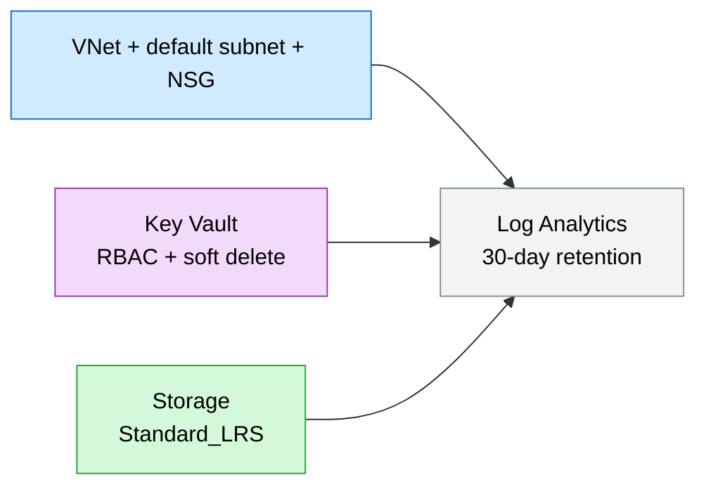
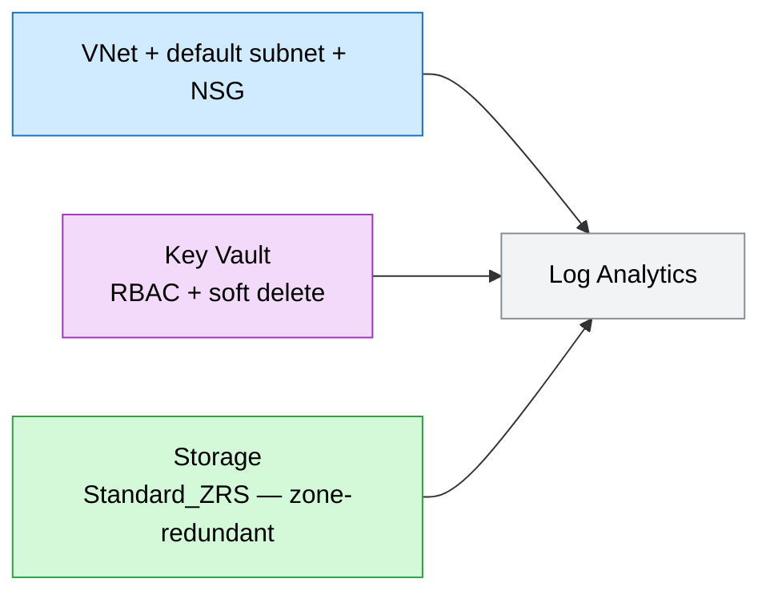

# Core Landing Zone (lite)

A minimal Azure landing zone for demos and MVPs: shared observability, secrets,
storage, and a hub network — a sensible base to build a use case on top of.

## Why this exists

Every workload needs the same handful of shared services — somewhere to send logs,
store state, and keep secrets, inside a governed network. Standing these up once,
consistently and as code, prevents snowflake environments and gives every
downstream use case a known-good base.

## Potential use cases

- Bootstrapping a demo or MVP subscription before deploying workloads
- A shared services resource group that multiple app teams build on
- Teaching the landing-zone concept (logging, secrets, network segmentation)
- A starting point you extend with private endpoints and policy for regulated workloads

## What gets deployed

- Log Analytics workspace (via shared module)
- Storage account (via shared module)
- Key Vault, RBAC-enabled (via shared module)
- Virtual network with a default subnet
- Network security group

## Well-Architected posture

- **Reliability** — durable storage defaults and regional Log Analytics; network segmentation via subnet + NSG.
- **Security** — Key Vault (RBAC, soft delete), hardened storage (TLS 1.2, HTTPS-only, no public blob), NSG-governed traffic.
- **Cost Optimization** — almost entirely consumption-based; VNet/NSG have no standing charge; 30-day log retention.
- **Operational Excellence** — single IaC entry point, consistent tagging, centralized logging.
- **Performance Efficiency** — fully managed PaaS components that scale without capacity planning.

See [metadata.json](metadata.json) for the machine-readable WAF + cost declaration.

## Parameters

| Name | Default | Description |
| --- | --- | --- |
| `location` | resource group location | Azure region |
| `environment` | `dev` | Environment name, used in tags |
| `prefix` | `techlabs` | Resource name prefix |
| `storageSku` | `Standard_LRS` | Storage redundancy (use `Standard_ZRS`/`Standard_GRS` in prod) |

## Architecture

### Dev



### Prod



## Deploy

```powershell
az group create --name rg-techlabs --location eastus

# Dev
az deployment group create `
  --resource-group rg-techlabs `
  --template-file ./main.bicep `
  --parameters ./parameters/dev.bicepparam

# Prod (zone-redundant storage)
az deployment group create `
  --resource-group rg-techlabs `
  --template-file ./main.bicep `
  --parameters ./parameters/prod.bicepparam
```

## Estimate cost

```powershell
./tools/Get-CatalogCost.ps1 -UseCase landing-zone/core
```

## Clean up

```powershell
az group delete --name rg-techlabs --yes --no-wait
```