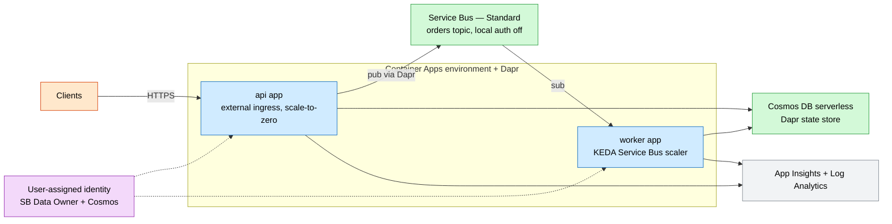
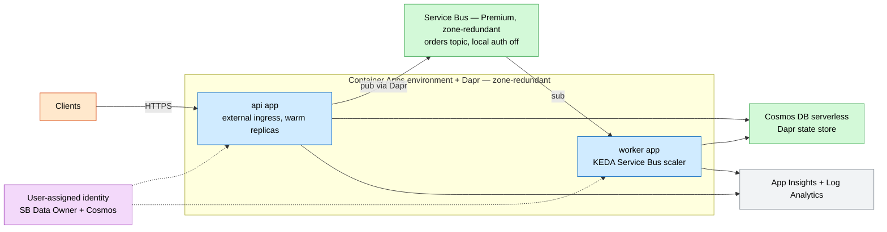

# Event-Driven Microservices (Container Apps + Dapr)

A keyless, event-driven microservices topology on **Azure Container Apps** with **Dapr**:
**Service Bus** pub/sub, a **Cosmos DB** Dapr state store, an external API, an internal
worker, and **KEDA** queue-depth autoscaling.

## What this deploys

- **Container Apps environment** with Dapr enabled and App Insights telemetry.
- **Dapr components** (scoped to both apps):
  - `statestore` → Cosmos DB (`state.azure.cosmosdb`).
  - `orderpubsub` → Service Bus topic (`pubsub.azure.servicebus.topics`).
- **API container app** — external HTTPS ingress, concurrency-based HTTP scaling.
- **Worker container app** — no ingress, **KEDA** Service Bus scaler (keyless via identity).
- **Service Bus** (Standard/Premium, local auth disabled) with an `orders` topic + dead-lettering subscription.
- **Cosmos DB** (serverless, keyless) state store.
- **User-assigned managed identity** shared by both apps, with Service Bus Data Owner + Cosmos data-plane roles.
- **Log Analytics** + **Application Insights**.

## Why this exists

Microservices teams want async messaging, durable state, and event-driven autoscaling
without running Kubernetes or managing broker credentials. Container Apps + Dapr provide
the building-block APIs; Service Bus and Cosmos supply the backbone; managed identity
removes every connection string.

## Potential use cases

- Order processing / saga workflows with a worker pool.
- Decoupled command and event services behind a single gateway.
- Burst-scaling background processing off a queue.
- Polyglot microservices needing portable state and pub/sub.

## Architecture

### Dev



### Prod



## Deploy

```bash
# Dev (scale-to-zero, Standard Service Bus)
az deployment group create -g <rg> -f main.bicep -p parameters/dev.bicepparam

# Prod (warm replicas, Premium Service Bus, zone-redundant)
az deployment group create -g <rg> -f main.bicep -p parameters/prod.bicepparam
```

## Well-Architected highlights

- **Reliability** — zone-redundant environment, Premium Service Bus, dead-lettering.
- **Security** — local auth disabled, shared least-privilege identity, HTTPS ingress.
- **Cost** — scale-to-zero + Standard broker in dev; KEDA scaling; serverless Cosmos.
- **Operations** — Dapr telemetry to App Insights; broker/store abstracted by Dapr.
- **Performance** — event-driven autoscale; concurrency-based HTTP scaling.

## Cost estimate

```powershell
./tools/Get-CatalogCost.ps1 -UseCase microservices-aca
```
