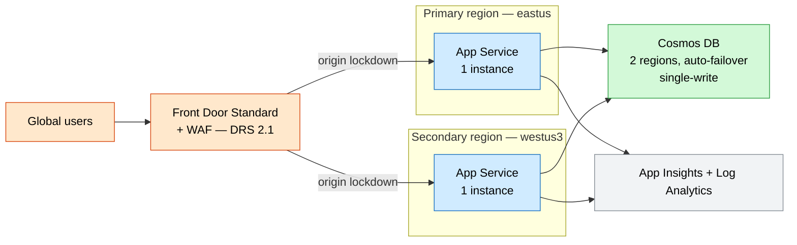
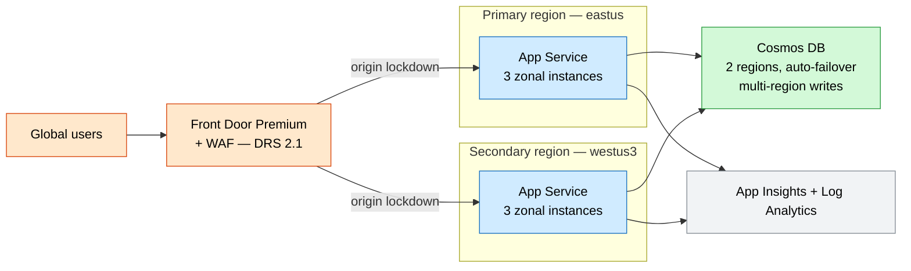

# Active-Active Multi-Region Web

A mission-critical global web footprint: **Azure Front Door Premium** with a managed
**WAF** load-balancing across **App Service** backends in two regions, backed by a
**multi-region Cosmos DB** with automatic failover.

## What this deploys

- **Front Door Premium** profile + endpoint + origin group with health probes.
- **WAF policy** (Microsoft DRS 2.1, Prevention) associated via a security policy.
- **App Service** plan + web app in a **primary** and a **secondary** region.
- Origin lockdown: each app accepts traffic **only from Front Door** (service tag `AzureFrontDoor.Backend` + `x-azure-fdid` header match).
- **Cosmos DB** replicated across both regions, automatic failover, optional multi-region writes, local auth disabled.
- Shared **Application Insights** + **Log Analytics**.

## Why this exists

Business-critical web workloads need to survive a regional outage and serve users with
low latency worldwide. This delivers an active-active footprint with a single global
anycast entry point, automated failover, and origin lockdown.

## Potential use cases

- Mission-critical customer portal with an availability SLO.
- Global e-commerce storefront needing low latency per geography.
- Regulated workload requiring regional resilience and DR.
- Public API needing global WAF and DDoS protection.

## Architecture

### Dev



### Prod



## Deploy

```bash
# Dev (Standard Front Door, single instances)
az deployment group create -g <rg> -f main.bicep -p parameters/dev.bicepparam

# Prod (Premium Front Door, 3 zonal instances/region, multi-write Cosmos)
az deployment group create -g <rg> -f main.bicep -p parameters/prod.bicepparam
```

## Well-Architected highlights

- **Reliability** — active-active regions, Cosmos auto-failover, probe-driven routing.
- **Security** — managed WAF, origin lockdown to Front Door, HTTPS-only, keyless Cosmos.
- **Cost** — Standard Front Door + single instances in dev; multi-write only in prod.
- **Operations** — shared App Insights/Log Analytics; region surfaced to the app.
- **Performance** — anycast edge routing to the nearest healthy origin.

## Cost estimate

```powershell
./tools/Get-CatalogCost.ps1 -UseCase multiregion-web
```
