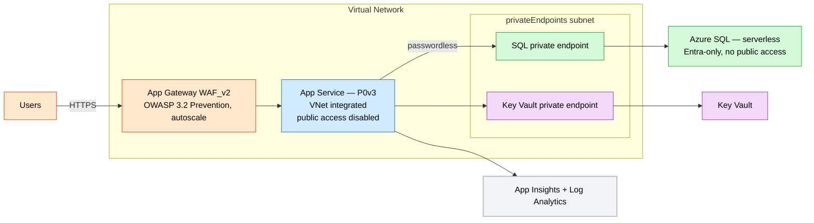
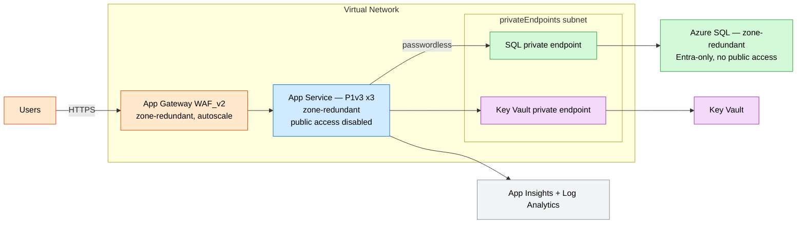

# Secure Web App Baseline (WAF + Private Data)

A network-hardened App Service reference architecture. The web tier integrates into a
VNet and reaches **Azure SQL** and **Key Vault** only over **private endpoints**; the
sole public entry point is an **Application Gateway** running an **OWASP WAF** policy.

## What this deploys

- **Virtual network** with `appGateway`, `appServiceIntegration` (delegated to App Service), and `privateEndpoints` subnets.
- **Linux App Service** (P-series) with regional VNet integration, `vnetRouteAllEnabled`, public network access **disabled**, system-assigned identity.
- **Azure SQL** server + database with `publicNetworkAccess: Disabled`, Entra-only auth, and a **private endpoint** + private DNS zone.
- **Key Vault** (RBAC, public access disabled) with a **private endpoint** + private DNS zone.
- **Application Gateway WAF_v2** (autoscaled, optionally zone-redundant) with an OWASP 3.2 policy in Prevention mode and a health probe.
- **Application Insights** + **Log Analytics**.

The app connects to SQL **passwordlessly** via `Active Directory Default` and reads
secrets from Key Vault by URI.

## Why this exists

Regulated web workloads typically cannot expose data services to the public internet
or accept unfiltered inbound traffic. This baseline closes both gaps while staying
passwordless, observable, and zone-redundant.

## Potential use cases

- Customer-facing portal handling regulated or PII data.
- Internal line-of-business app reachable only through the WAF.
- Lift-and-shift of a public web app into a private-networking posture.
- PCI-scoped checkout or account-management front end.

## Architecture

### Dev



### Prod



## Deploy

> Set `sqlAdminObjectId` / `sqlAdminLogin` to an Entra user or group that should own the SQL server.

```bash
# Dev
az deployment group create -g <rg> -f main.bicep -p parameters/dev.bicepparam

# Prod (zone-redundant)
az deployment group create -g <rg> -f main.bicep -p parameters/prod.bicepparam
```

## Well-Architected highlights

- **Reliability** — zone-redundant plan, gateway, and SQL in prod; health-probe-driven backend.
- **Security** — private-only data tier, passwordless SQL, OWASP WAF as the only public surface.
- **Cost** — serverless SQL and P0v3 in dev; gateway autoscales.
- **Operations** — App Insights + Log Analytics; secrets in Key Vault.
- **Performance** — HTTP/2, Always On, gateway autoscale.

## Cost estimate

```powershell
./tools/Get-CatalogCost.ps1 -UseCase secure-web-app
```
