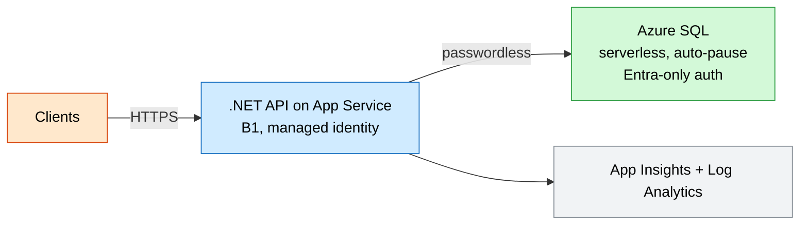
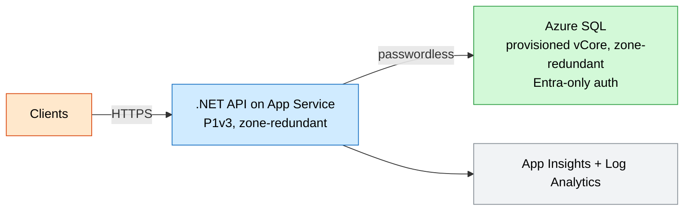

# SQL Data API (App Service + Azure SQL)

A .NET API on App Service backed by Azure SQL Database, wired for **passwordless**
access: the web app's managed identity authenticates to SQL, and the SQL server
uses **Microsoft Entra-only** authentication (no SQL logins, no stored passwords).
Dev runs serverless SQL that auto-pauses; prod runs zone-redundant compute and
database.

## Why this exists

Most business apps are a stateless API in front of a relational database. Doing it
passwordlessly (managed identity + Entra-only SQL) removes the most common security
failure - leaked connection strings - while the dev/prod split keeps lab costs low
and production resilient.

## Potential use cases

- A CRUD/business API over relational data (orders, customers, inventory)
- Modernizing a legacy app's data tier to managed Azure SQL
- Demonstrating passwordless, Entra-only database access patterns
- A reporting or back-office API that needs transactional consistency

## What gets deployed

| Component | Purpose | Module |
| --- | --- | --- |
| Log Analytics workspace | Central log store | [log-analytics](../../modules/log-analytics/main.bicep) |
| Application Insights | App monitoring | [app-insights](../../modules/app-insights/main.bicep) |
| App Service plan + Web App | API tier with managed identity | inline |
| Azure SQL server + database | Data tier, Entra-only auth | inline |

## Well-Architected posture

- **Reliability** — zone-redundant app plan and SQL database in prod; automated SQL backups with point-in-time restore.
- **Security** — Entra-only SQL auth, passwordless managed-identity connection, HTTPS-only + TLS 1.2.
- **Cost Optimization** — serverless auto-pause SQL in dev; provisioned vCore in prod sized to load.
- **Operational Excellence** — centralized telemetry, IaC dev/prod params, Entra admin as a group.
- **Performance Efficiency** — vCore SQL scaling, Premium v3 app compute in prod.

See [metadata.json](metadata.json) for the machine-readable WAF + cost declaration.

> **Before you deploy:** set `sqlAdminObjectId` and `sqlAdminLogin` in the
> parameter file to a Microsoft Entra user or group that should administer SQL.
> After deployment, grant the web app's managed identity database access (e.g.
> `CREATE USER [<web-app-name>] FROM EXTERNAL PROVIDER;` then add it to the
> required roles).

## Parameters

| Name | Default | Description |
| --- | --- | --- |
| `location` | resource group location | Azure region |
| `environment` | `dev` | Environment name |
| `prefix` | `techlabs` | Resource name prefix |
| `appServiceSku` | `B1` | App plan SKU (P1v3+ for zone redundancy) |
| `appCapacity` | `1` | App plan instance count |
| `appZoneRedundant` | `false` | Zone-redundant app plan |
| `sqlSkuName` | `GP_S_Gen5_1` | SQL database SKU |
| `sqlTier` | `GeneralPurpose` | SQL service tier |
| `sqlZoneRedundant` | `false` | Zone-redundant SQL database |
| `sqlAdminObjectId` | — | Entra admin object id (required) |
| `sqlAdminLogin` | — | Entra admin display name (required) |

## Architecture

### Dev



### Prod



## Deploy

```powershell
az group create --name rg-techlabs-sql --location eastus

# Dev (serverless SQL)
az deployment group create `
  --resource-group rg-techlabs-sql `
  --template-file ./main.bicep `
  --parameters ./parameters/dev.bicepparam

# Prod (zone-redundant)
az deployment group create `
  --resource-group rg-techlabs-sql `
  --template-file ./main.bicep `
  --parameters ./parameters/prod.bicepparam
```

## Estimate cost

```powershell
./tools/Get-CatalogCost.ps1 -UseCase sql-data-api
```

## Clean up

```powershell
az group delete --name rg-techlabs-sql --yes --no-wait
```
