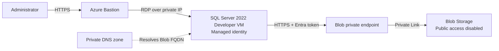

# SQL Server VM with Private Blob Storage

This use case deploys SQL Server 2022 Developer on a Windows Server VM with no
public IP. Administrators connect through Azure Bastion. The VM reaches a
StorageV2 account through a Blob private endpoint and private DNS, using its
system-assigned managed identity for Blob authorization.

> SQL Server Developer edition is licensed for development and testing only.
> Use an appropriately licensed SQL Server edition for production workloads.

## What gets deployed

| Component | Purpose |
| --- | --- |
| Virtual network and three subnets | Isolates the SQL VM, private endpoint, and Azure Bastion |
| SQL Server 2022 Developer VM | Private Windows Server and SQL Server workload |
| SQL IaaS Agent extension | Registers the VM for Azure SQL VM management |
| Azure Bastion and public IP | Browser-based administration without a VM public IP |
| StorageV2 account | Private Blob storage with shared keys and public access disabled |
| Blob private endpoint and private DNS | Private Blob connectivity and name resolution |
| Managed identity role assignment | Grants the VM Storage Blob Data Contributor at storage account scope |

## Parameters

| Name | Default | Description |
| --- | --- | --- |
| `location` | Resource group location | Azure region |
| `environment` | `dev` | Environment name |
| `prefix` | `techlabs` | Short resource name prefix |
| `vmSize` | `Standard_D4s_v5` | SQL Server VM size |
| `adminUsername` | `sqladmin` | Local Windows administrator |
| `adminPassword` | Empty import placeholder; override before deployment | Local Windows administrator password |
| `storageSkuName` | `Standard_LRS` | Storage redundancy SKU |
| `vnetAddressPrefix` | `10.20.0.0/16` | VNet address space |
| `vmSubnetPrefix` | `10.20.1.0/24` | SQL VM subnet prefix |
| `privateEndpointSubnetPrefix` | `10.20.2.0/24` | Private endpoint subnet prefix |
| `bastionSubnetPrefix` | `10.20.3.0/26` | Azure Bastion subnet prefix |

## Architecture



The private endpoint belongs to the Storage account, not the VM. The SQL VM
uses its private NIC to reach the endpoint over the shared VNet.

## Deploy with Bicep

The empty secure default permits catalog import without publishing a literal
password in either environment's parameter file. It is not a valid VM password.
The personal portal does not expose secure parameters in its deployment form;
use a reviewed Key Vault parameter reference or supply the password securely
when deploying outside the portal.

Supply the administrator password at deployment time so it is not stored in a
parameter file.

```powershell
az group create --name rg-sql-private-endpoint-dev-eastus2-001 --location eastus2

$adminPassword = Read-Host 'SQL VM administrator password' -AsSecureString

az deployment group create `
  --resource-group rg-sql-private-endpoint-dev-eastus2-001 `
  --template-file ./main.bicep `
  --parameters ./parameters/dev.bicepparam `
  --parameters adminPassword=$adminPassword
```

## Deploy with Terraform

Set the password through a sensitive Terraform variable rather than a tracked
`.tfvars` file.

```powershell
$env:TF_VAR_admin_password = Read-Host 'SQL VM administrator password'

terraform -chdir=terraform init
terraform -chdir=terraform apply -var-file=dev.tfvars
```

## Validate private Blob access

Connect to the VM through Azure Bastion. Confirm that the Blob hostname resolves
to the private endpoint address and request a managed identity token:

```powershell
Resolve-DnsName <storage-account-name>.blob.core.windows.net

$token = Invoke-RestMethod `
  -Headers @{ Metadata = 'true' } `
  -Uri 'http://169.254.169.254/metadata/identity/oauth2/token?api-version=2018-02-01&resource=https%3A%2F%2Fstorage.azure.com%2F'
```

For SQL Server 2022 backup-to-URL scenarios, create a SQL credential that uses
managed identity after the VM role assignment has propagated:

```sql
CREATE CREDENTIAL [https://<storage-account-name>.blob.core.windows.net/<container>]
WITH IDENTITY = 'Managed Identity';
```

## Clean up

```powershell
az group delete --name rg-sql-private-endpoint-dev-eastus2-001 --yes --no-wait
```