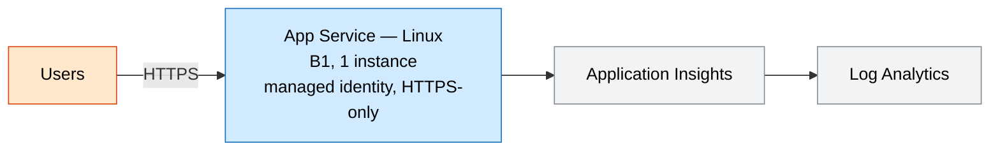
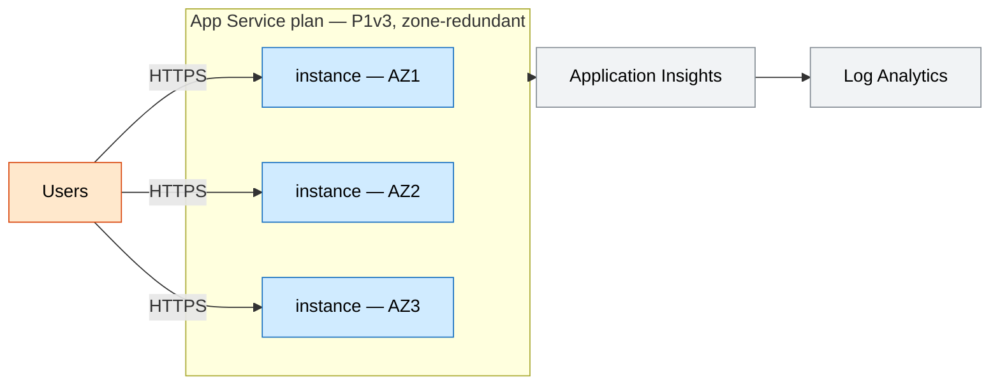

# Web App (PaaS)

A minimal, production-shaped Azure Web App stack for demos and MVPs: a Linux
App Service running your code, wired to Application Insights and Log Analytics
for telemetry out of the box. Dev is cheap and single-instance; prod is
zone-redundant.

## Why this exists

App Service is the fastest way to host a web app or API on Azure without managing
servers. Wiring identity, HTTPS hardening, health checks, and monitoring from the
start means the same template carries a demo all the way to a resilient production
footprint.

## Potential use cases

- Hosting a company website, marketing site, or customer portal
- A REST/GraphQL API backing a SPA or mobile app
- A line-of-business app that needs HA without container/Kubernetes overhead
- A demo or MVP you later scale to production by switching to the prod profile

## What gets deployed

| Component | Purpose | Module |
| --- | --- | --- |
| Log Analytics workspace | Central log/metric store | [log-analytics](../../modules/log-analytics/main.bicep) |
| Application Insights | App performance monitoring | [app-insights](../../modules/app-insights/main.bicep) |
| App Service plan (Linux) | Compute tier | inline |
| Web App | HTTPS-only site with managed identity | inline |

## Well-Architected posture

- **Reliability** — prod plan is zone-redundant (P1v3, 3 instances across AZs); platform health checks evict unhealthy instances.
- **Security** — system-assigned managed identity, HTTPS-only, TLS 1.2, FTPS disabled. Put secrets in Key Vault and reference via the identity.
- **Cost Optimization** — dev runs B1; prod runs Premium v3. Scale `capacity` to demand; consider reservations/savings plans for steady load.
- **Operational Excellence** — centralized telemetry, IaC with dev/prod parameter files, health endpoint for probes/alerts.
- **Performance Efficiency** — HTTP/2, Premium v3 compute, autoscale-ready via `capacity`.

See [metadata.json](metadata.json) for the machine-readable WAF + cost declaration.

## Parameters

| Name | Default | Description |
| --- | --- | --- |
| `location` | resource group location | Azure region |
| `environment` | `dev` | Environment name, used in resource names and tags |
| `prefix` | `techlabs` | Resource name prefix |
| `sku` | `B1` | App Service plan SKU (P1v3+ to allow zone redundancy) |
| `capacity` | `1` | Plan instance count (>= 3 for zone redundancy) |
| `zoneRedundant` | `false` | Spread instances across availability zones |
| `linuxFxVersion` | `DOTNETCORE 8.0` | Runtime stack (e.g. `NODE 20-lts`, `PYTHON 3.12`) |
| `healthCheckPath` | `/health` | Health probe path |

## Architecture

### Dev



### Prod



## Deploy

```powershell
az group create --name rg-techlabs-webapp --location eastus

# Dev (single Basic instance)
az deployment group create `
  --resource-group rg-techlabs-webapp `
  --template-file ./main.bicep `
  --parameters ./parameters/dev.bicepparam

# Prod (zone-redundant Premium v3)
az deployment group create `
  --resource-group rg-techlabs-webapp `
  --template-file ./main.bicep `
  --parameters ./parameters/prod.bicepparam
```

## Estimate cost

```powershell
./tools/Get-CatalogCost.ps1 -UseCase web-app
```

## Clean up

```powershell
az group delete --name rg-techlabs-webapp --yes --no-wait
```
